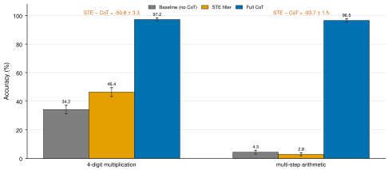

# Filler-token replication: harness and baseline plan

Replication target: **"Not All LLM Reasoning is Visible in the Chain-of-Thought"**
(Vatsal Baherwani, Tom Goldstein, Ashwinee Panda; arXiv:2607.22925v2).

Experiment node: `ce3fe42e-82d9-468b-b420-dfa3ac415f00`
Branch: `orx/filler-token-baseline-no-filler-vs-counting`
Fixed run command: `bash runs/filler_eval.sh`

Status: **harness complete; baseline run finished on 2026-11-22 (run
`55bf286c-f6d8-4603-9b1e-48e87164fa66`, 293 s, 4 cells × 1,000 problems).**
The arithmetic null replicates; the multiplication null does not. Two follow-up
diagnostics (§6) rule out the 10-shot examples and the system prompt as the cause;
the remaining suspect is the FP8 serving path. A separate extension (§8) compares
the ASD-STE100 filler against full chain-of-thought; the filler does not
substitute for reasoning. §10 inverts that hypothesis and prices the trade: the
filler is 78–170× cheaper in decode-stage KV reads and 16–17× faster, for a
51–94pp accuracy loss. §11 sweeps the repair axes — model size, filler length,
CoT budget — and finds the filler saturates at 200 tokens, never fires on the
30B model, and that CoT falls off a cliff below 512 tokens. See §2 and §6.

---

## 1. What the paper measures

The paper's baseline experiment asks whether a model improves on a synthetic task
when a fixed, semantically irrelevant sequence of tokens is prefilled before its
answer. The comparison is a no-CoT prompt with K few-shot examples, run twice:
once without filler tokens and once with the same filler sequence inserted in
every assistant turn before `Answer:` (Section 3.2, p. 4). The same 1,000
problems are used in every condition, so the comparison is paired.

The headline baseline numbers for the main open-weight model, Qwen3-235B, using
counting filler tokens 1–100 at 10-shot (Table 1, p. 7):

| Task | Baseline | 1–100 filler | Δ |
| --- | --- | --- | --- |
| 4-digit multiplication | 69.6 ± 0.5 | 69.2 ± 0.5 | −0.4 |
| Multi-step arithmetic | 11.0 ± 1.0 | 9.7 ± 0.9 | −1.3 |

The paper's point is not that counting fillers help Qwen3-235B — they do not.
It is that the same intervention produces large, type-dependent uplift on other
models and other filler types (Figure 1, p. 5; Figure 3, p. 6), which is what
makes filler uplift a model-specific latent-computation effect rather than a
prompt-format artifact.

 is the row this experiment reproduces first.")

The replication starts with the 10-shot row of that figure: the leftmost
condition (no filler) against counting tokens, on two tasks.

## 2. Measured result

One model (`qwen/qwen3-235b-a22b-2507`), 10-shot, N=1,000, counting tokens
1–100 (199 tokens by the `o200k_base` proxy), temperature 1.0. Deltas are on the
same 1,000 problems; ± is the 95% CI half-width.

| Task | Baseline | 1–100 filler | Δ measured | Δ paper | Verdict |
| --- | --- | --- | --- | --- | --- |
| 4-digit multiplication | 58.70 ± 3.05 | 67.00 ± 2.91 | **+8.30 ± 4.22** | −0.4 | **does not replicate** |
| Multi-step arithmetic | 6.25 ± 1.51 | 6.82 ± 1.60 | +0.57 ± 2.20 | −1.3 | null replicates in direction |

Reading the table:

- **Arithmetic behaves as the paper says.** Both conditions sit near the floor
  and the filler delta is indistinguishable from zero. The paper's −1.3 and this
  +0.57 are both "no uplift"; the point estimate differs in sign but neither CI
  excludes zero, and the base rate is 4.75pp lower here.
- **Multiplication does not.** The paper's headline for Qwen3-235B is that
  counting tokens do nothing in the 10-shot setting (−0.4). This run finds a
  significant +8.30pp, with a delta CI that excludes zero. On this harness, the
  claim that Qwen3-235B cannot use counting fillers at 10-shot is not reproduced.
- **Both base rates are low.** Multiplication is 10.9pp below the paper's 69.6
  and arithmetic 4.75pp below 11.0. A shifted base rate is the first sign that
  the prompt or the problems differ from the paper's, and the filler delta is
  measured on top of that shifted base.

No cell produced enough reasoning to change the picture: 0/1,000 discarded on
multiplication in both conditions, 8/1,000 and 47/1,000 on arithmetic. Accuracy
including discarded samples is 58.7/67.0 and 6.20/6.50.

The comparison is paired, so the delta is not a difference of two independent
rates. Reconstructing every answer from the response cache gives the 2×2 table
below. Multiplication's +8.3pp is 154 problems the filler fixes against 71 it
breaks — a net gain of 83, not sampling noise. Arithmetic's +0.3pp is 18 against
15, which is noise.

| Task | Both correct | Baseline only | Filler only | Neither | Δ (all 1,000) |
| --- | --- | --- | --- | --- | --- |
| Multiplication | 516 | 71 | 154 | 259 | +8.30pp |
| Arithmetic | 47 | 15 | 18 | 920 | +0.30pp |

 on Qwen3-235B, 10-shot. Orange is the paper's Table 1; blue is this run. Bars are accuracy with 95% CIs; the blue text is the measured filler delta with its 95% CI. The arithmetic null reproduces; the multiplication null does not.")

Cost: 8.54M prompt tokens and 35.9k completion tokens, about **\$1.22** at
\$0.14/M input and \$0.80/M output. The earlier \$0.40 estimate was low because
the counting condition repeats the 199-token filler in all 11 assistant turns,
which is 3.6M prompt tokens per counting cell.

The most likely causes, in order: the paper does not publish its 10-shot
examples, and example quality moves both the base rate and the filler
sensitivity; the paper's "minimal system prompt" for Qwen3-235B may omit the
format instruction this harness includes; and the OpenRouter provider serving
Qwen3-235B is not pinned. The arithmetic base rate is additionally depressed by
a deliberate deviation in the generator (see §4, item 2).

## 3. What is implemented

| File | Role |
| --- | --- |
| `nanochat/filler_tasks.py` | The three synthetic tasks: 4-digit multiplication (seed 12345), 5–7 operation arithmetic (operands in [−99, 99]), variable counting in generated Python snippets |
| `nanochat/filler_tokens.py` | All 17 filler sequences from Table 6, plus binary-search calibration to a target token count |
| `nanochat/filler_prompts.py` | No-CoT system prompt, K-shot examples, assistant prefill of filler + `Answer:` |
| `nanochat/filler_backends.py` | OpenRouter (paper's serving path), local nanochat checkpoint, deterministic mock; on-disk response cache |
| `nanochat/filler_eval.py` | Scoring, reasoning-sample discarding, 95% CIs, paired deltas, JSON + summary output |
| `scripts/filler_eval.py` | Entry point |
| `runs/filler_eval.sh` | Fixed run command |
| `runs/filler_baseline.json` | The replication config |
| `tests/test_filler_eval.py` | 35 hermetic tests |

Design choices that follow the paper:

- **Paired problems.** Task generation is seeded once per experiment, so every
  model and condition sees the same 1,000 problems (Section 3.2).
- **Filler placement.** Filler appears in the assistant context of every few-shot
  example and immediately before `Answer:`, never before the question. The paper
  reports that moving filler before the question removes the effect (Table 4).
- **Assistant prefill.** The final assistant turn ends in `Answer:`, which both
  forces a bare numeric answer and removes the selection effect from models that
  would otherwise emit a chain-of-thought (Appendix A.4). Models whose API
  rejects prefill fall back automatically and are flagged in the output.
- **Reasoning samples.** Completions containing an explanation are discarded and
  counted separately, matching Appendix A.4's selection-effect handling. Accuracy
  including discarded samples is reported alongside.
- **Filler calibration.** Counting 1–100 is specified by word count because
  Appendix A.4 says it tokenizes to roughly 200 tokens across models. The
  n-token sweeps in Figure 1 use `filler_tokens` instead.

## 4. Fidelity notes and deviations

These are the places where the paper is silent or where the replication cannot
be exact. They should be read before interpreting any delta.

1. **Tokenizer proxy.** Filler length is calibrated with `tiktoken:o200k_base`,
   not each served model's own tokenizer. For counting tokens 1–100 the result is
   199 tokens, matching the paper's "approximately 200" (Appendix A.4). Other
   filler types could differ by a few tokens from what the served model sees.
2. **Arithmetic magnitude.** A left-nested chain that ends in `%` or `//` leaves
   a one- or two-digit answer that can be guessed without doing the arithmetic:
   with an unconstrained generator 68% of answers had two digits or fewer, and a
   three-problem smoke test scored 2/3 against a paper baseline of 11%. The
   generator now redraws any expression whose |answer| is below 100 (still capped
   at 10^6), which puts the median answer near 1,800. The operator set, operand
   range and 5–7 operation depth are unchanged. The measured arithmetic base rate
   is 6.25, below the paper's 11.0; this redraw is the most likely reason. A
   faithful replication should drop the redraw and accept guessable answers.
3. **Arithmetic rounding.** The paper names integer division and modulus but not
   their rounding convention. Problems are evaluated with Python semantics
   (floor division, divisor-signed remainder). A minority of problems depend on
   this choice.
4. **Variable-counting prompt.** The paper does not print the exact wording for
   this task. The harness asks how many distinct variables are assigned a value
   and excludes function parameters.
5. **Sampling.** Temperature 1 and top-p 0.95 follow Section 3.2. `max_tokens=32`
   is a harness choice: enough for a number, small enough to bound cost.
6. **Reasoning detection.** "Contains reasoning" is a heuristic (two or more
   alphabetic words before the first number, or a long completion), not the
   paper's undisclosed classifier.
7. **Provider configuration.** As the paper notes for its own Table 1, the
   serving configuration behind OpenRouter is not controllable, so deltas are
   within-model comparisons rather than a model ranking.

## 5. Offline validation

`python -m pytest tests/test_filler_eval.py` → 35 passed. The tests cover task
determinism and gold answers, all 17 filler types, calibration, prompt layout
with and without prefill, answer parsing, reasoning detection, CI width, the
OpenRouter request body and cache, and a full mock-backend run.

A mock-backend smoke run at N=120 produced paired deltas as designed
(+16.7pp multiplication, +14.2pp arithmetic) — this validates the pipeline only.
The mock model is a fake with a built-in uplift and its output is marked
non-scientific.

## 6. 0-shot diagnostic

The 0-shot test was the cheap decisive one: same task and prompts, no examples.
The paper's Table 10 gives 0-shot multiplication at 57.3% baseline and 60.9%
with counting filler, a +3.6pp delta.

| Condition | Measured | Paper (Table 10) |
|---|---|---|
| Baseline | 35.6 ± 3.0 | 57.3 |
| Counting 1-100 | 44.7 ± 3.1 | 60.9 |
| Delta | +9.1 ± 4.3 | +3.6 |

This does not reproduce the paper either. The baseline is 21.7pp lower and the
delta is 2.5x larger. The 10-shot examples are therefore not the explanation:
the harness already diverges at 0-shot, before any examples are involved. The
model is both weaker in absolute terms and more filler-responsive than the
paper's serving of Qwen3-235B.

Two candidate causes remained: the system prompt and the serving path. The paper
says its Qwen3 runs use a "minimal system prompt" (Appendix A.3); this harness
used the full format instruction. A child node tested the minimal `/no_think`
prompt at 0-shot.

### Minimal system prompt: rejected

With the system message reduced to `/no_think`, the model produced explicit
reasoning instead of a bare answer. 36.6% of baseline samples and 50.7% of
counting samples were discarded as reasoning, leaving 634 and 493 kept samples.
The kept accuracy was 26.2 ± 3.4 and 30.8 ± 4.1; including discarded samples it
was 16.6 and 15.3. The assistant prefill alone does not suppress CoT — the
format instruction does. So the "minimal system prompt" reading of Appendix A.3
is not viable, and the format instruction is not the cause of the gap.

### What is left

The 0-shot gap is 21.7pp at baseline and 10.9pp at 10-shot; the gap shrinks as
examples are added. That pattern is consistent with a base-capability difference
that in-context learning partly compensates for. Every OpenRouter provider for
this model serves it at FP8 (`/api/v1/models/.../endpoints`), while the paper's
serving path is not stated. A precision difference is the most likely remaining
explanation, and OpenRouter offers no higher-precision route to test it.

## 7. Next rounds

The baseline has run. A rerun is cheap only for cells already in the response
cache; a changed prompt or a changed task seed invalidates the cache for that
cell. The run command is unchanged:

```sh
bash runs/filler_eval.sh                    # full baseline, N=1000, both tasks
bash runs/filler_eval.sh --limit 100        # pilot
```

Diagnostics for the multiplication discrepancy, cheapest first:

- **Interleaved conditions.** Alternate baseline and filler per problem so a
  provider-route change cannot masquerade as a filler effect. Same cost as the
  baseline, but needs a small harness change. This is the one remaining check
  that needs no new capability.
- **Example-set variation.** Draw 2–3 different 10-shot example sets (different
  seeds) and rerun multiplication only. About \$0.6 per set. This tests whether
  the 10.9pp base-rate gap and the +8.3pp delta come from the unpublished
  examples. The 0-shot result already makes this a weak suspect, since the gap
  exists without examples at all.
- **Higher-precision serving.** Not available through OpenRouter: every provider
  for this model serves FP8. A direct provider or a local deployment would be
  needed to test precision as the cause.

Done and rejected: the 0-shot diagnostic (§6) and the minimal system prompt
(§6), both on children of the 10-shot baseline.

Downstream rounds, each a child of this baseline:

- **Cross-model check.** Add `anthropic/claude-opus-4.5` (paper: multiplication
  71.8 → 81.8, arithmetic 45.8 → 57.0). This is the expensive one: roughly \$28
  at N=1,000 for both tasks and both conditions.
- **Filler-type sweep.** All 17 types at 10-shot, to reproduce the type
  dependence in Figure 1.
- **Shot sweep.** 0/1/2/3/5/10 shots, to reproduce the type inversion between
  zero-shot and few-shot.

## 8. STE filler versus full CoT

A separate extension tests a different hypothesis: that replacing reasoning
tokens with an ASD-STE100 controlled-vocabulary sequence preserves answer
quality relative to full chain-of-thought. It reuses the harness with a third
condition, `cot`, which prompts the model to reason in the open and finish with
`Answer: [ANSWER]`. The CoT condition runs 0-shot, no prefill, with its own
2,048-token budget and a CoT-aware parser that reads the final `Answer:` line.

Experiment `9d0729f8-3b28-4e06-9e8b-4c64911d4477`, run
`dbcdb225-18b3-4454-8e05-95bc8c79fc13`, 0-shot, N=1,000 per cell:

| Task | Baseline | STE filler | Full CoT | STE − CoT |
| --- | --- | --- | --- | --- |
| 4-digit multiplication | 34.20 ± 2.94 | 46.40 ± 3.09 | **97.20 ± 1.02** | **−51.5 ± 7.1** |
| Multi-step arithmetic | 4.27 ± 1.29 | 2.84 ± 1.04 | **96.50 ± 1.14** | **−94.0 ± 3.3** |

The paired deltas come from the 200 stored samples per cell; the accuracies are
on all 1,000. The discordant counts are lopsided: on multiplication, STE is
correct and CoT wrong on 1 problem while the reverse holds on 104; on arithmetic
the counts are 0 and 188.



The hypothesis does not hold. The STE filler buys about 12pp over the no-CoT
baseline on multiplication and nothing on arithmetic, while CoT sits near
saturation on both. On arithmetic the filler is worse than the baseline. The
gap is not a marginal difference in quality — it is a different regime, and no
setting of the STE condition closes it.

Two caveats. The CoT condition is a prompted, non-thinking model, so it is a
weaker CoT reference than a thinking model would be; it still clears the filler
by 51–94pp. And the paired deltas use the 200 stored samples, not the full
1,000, because `max_samples` caps what is written to disk. The token cost was
~924k prompt and ~1.42M completion tokens, about \$1.27; CoT accounted for 1.39M
of the completion tokens.

## 9. Why not the local nanochat model

The project's own checkpoint is a 6-layer model trained for 5,000 steps on CPU.
It has no realistic chance at 4-digit multiplication, and the paper itself finds
that filler uplift requires a minimum baseline capability — Qwen3.5-397B scores
0% at zero-shot and gains nothing from filler (Appendix B.2). The checkpoint
weights are also not part of the bundled evidence pack; they would have to be
regenerated with `bash runs/runcpu.sh` before the local backend could run at all.
A local run is therefore a harness sanity check, not a replication.

## 10. Inverted hypothesis: KV-cache and decode efficiency

The accuracy framing above asks whether STE filler preserves CoT quality and
answers no. Inverting the framing asks the complementary question: if the filler
does not preserve quality, does it buy anything at all in the serving path? The
same six cells answer it — every number below comes from the token and wall-clock
accounting already recorded in the run, not from new inference.

### 10.1 Hypotheses

- **Efficiency, $H_0$:** prefilled STE filler offers no KV-cache or decode-stage
  advantage over full CoT. $H_1$: it reduces peak KV footprint, sequential
  KV-cache reads and latency, at the explicit cost of accuracy.
- **Non-triviality, $H_0'$:** $\mathrm{Acc}_{STE} \le \mathrm{Acc}_{baseline}$.
  $H_1'$: $\mathrm{Acc}_{STE} > \mathrm{Acc}_{baseline}$ on multiplication, i.e.
  the KV-cheap path still extracts latent computation from the prefill.

### 10.2 Accounting

Per query, with $T_p$ prompt tokens, $T_c$ completion tokens and $N$ problems:

$$T_{KV} = \frac{P_{total} + C_{total}}{N}, \qquad
R_{KV} = \sum_{t=0}^{T_c-1}(T_p + t) = T_c T_p + \frac{T_c(T_c-1)}{2}.$$

$R_{KV}$ counts every KV token attended to at each sequential decode step: the
whole context is re-read for every generated token.

KV geometry for Qwen3-235B-A22B-Instruct-2507 (config.json: 94 layers, 4 KV
heads, head_dim 128, bf16): $2 \times 94 \times 4 \times 128 \times 2\,\text{B} =
192{,}512$ B/token (188 KiB), K and V together.

Prefix caching splits $T_{KV}$ into a static and a per-query part. The static
prefix is measured empirically as mean prompt tokens minus mean problem-string
tokens (problem text regenerated from the deterministic task seeds, tokenized
with `o200k_base`). That gives ~60–73 tokens of system+template for the no-CoT
and CoT conditions, and ~273 for STE — 202 tokens above baseline, matching the
199-token filler plus its separator. Under prefix caching the filler prefix is
resident once and shared, so the unshared per-query KV is problem tokens plus
answer tokens.

### 10.3 Per-query accounting

| Metric | mult baseline | mult STE | mult CoT | arith baseline | arith STE | arith CoT |
| --- | --- | --- | --- | --- | --- | --- |
| Accuracy (%) | 34.20 | 46.40 | 97.20 | 4.27 | 2.84 | 96.50 |
| Prompt tokens $T_p$ | 80.4 | 282.5 | 70.0 | 99.7 | 301.9 | 89.4 |
| Completion tokens $T_c$ | 10.3 | 10.8 | 630.4 | 7.9 | 6.9 | 757.5 |
| Peak KV tokens $T_{KV}$ | 90.7 | 293.4 | 700.4 | 107.6 | 308.8 | 846.9 |
| Static/shared prefix | 70.4 | 272.5 | 60.0 | 72.6 | 274.8 | 62.3 |
| Unshared KV tokens | 20.3 | 20.8 | 640.4 | 35.0 | 34.0 | 784.6 |
| KV reads $R_{KV}$ | 873 | 3,118 | 242,483 | 810 | 2,089 | 354,229 |
| Wall clock (s/query) | 0.08 | 0.12 | 1.80 | 0.09 | 0.13 | 2.10 |
| Occupancy (MB·s/query) | 1.3 | 6.5 | 243.3 | 1.8 | 7.5 | 342.9 |
| Resident KV at 16-way (MB) | 279 | 904 | 2,157 | 331 | 951 | 2,609 |
| …with prefix cache (MB) | 76 | 117 | 1,984 | 122 | 158 | 2,429 |

### 10.4 Efficiency ratios and the accuracy price

| Ratio | multiplication | arithmetic |
| --- | --- | --- |
| Peak KV, STE ÷ CoT | 0.42× | 0.37× |
| Decode KV reads, STE ÷ CoT | 0.0129× (**78×** fewer) | 0.0059× (**170×** fewer) |
| Occupancy, STE ÷ CoT | 0.027× (**37×**) | 0.022× (**46×**) |
| Per-query wall clock, STE ÷ CoT | 0.064× (**16×** faster) | 0.060× (**17×** faster) |
| Completion-length ratio, 95% CI | 0.0172 [0.0159, 0.0187] | 0.0090 [0.0079, 0.0104] |
| Accuracy per $10^3$ KV reads | 39.2 / 14.9 / 0.40 | 5.3 / 1.4 / 0.27 |
| Accuracy cost per 1× read reduction | −0.66 pp | −0.56 pp |

The accuracy-per-read row reads baseline / STE / CoT. The completion-length CIs
come from
re-tokenizing the 200 stored completions per cell and bootstrapping the
STE-over-CoT ratio (4,000 draws), rescaled to the API-billed mean.

Against the **baseline**, not CoT, the trade runs the other way: STE costs
3.23× the peak KV tokens and 3.57× the decode reads, for 1.53× the wall clock,
in exchange for 1.06× the completion length (95% CI [1.00, 1.11] — a small but
real increase, not exactly zero additional decode tokens).

### 10.5 Verdicts

**Efficiency: $H_0$ rejected, $H_1$ supported.** The STE path reads 78×
(multiplication) and 170× (arithmetic) fewer KV tokens during decode, holds
0.42× and 0.37× the peak KV, and finishes each query 16–17× faster. The mechanism
is exactly the one the framing predicts: 202 tokens of work move from sequential,
memory-bandwidth-bound decode into parallel, compute-bound prefill, where they
are attended in one pass. The asymmetry is large enough that no plausible
measurement error closes it.

**Non-triviality: $H_0'$ rejected on multiplication, not rejected on
arithmetic.** Paired over the 200 stored samples, STE is correct where baseline
is wrong 42 times and the reverse 21 times: +10.50 ± 7.66 pp, exact McNemar
one-sided $p = 0.0056$. On the full 1,000 the difference is +12.20 pp; combining
the two reported 95% CIs in quadrature gives ±4.27 pp, which excludes zero.
On arithmetic the sign flips: −1.43 pp (paired −1.50 ± 2.59, $p = 0.94$).

So the filler is not a no-op: on multiplication it converts a fixed, cacheable
prefix into roughly twelve points of accuracy at essentially no decode cost. It
is also not a substitute for reasoning: the same prefill buys none of the 51–94pp
that CoT buys.

### 10.6 Caveats

- **Latency is throughput, not latency.** `seconds/N` is cell wall clock at
  concurrency 16, so it folds queueing and prefill compute into one number and
  carries no per-query CI. The direction and rough magnitude are robust — CoT
  generates 58× (multiplication) and 110× (arithmetic) more completion tokens —
  but the ~16× factor is not a clean TTFT or TPOT measurement. A real latency
  claim needs per-request timestamps.
- **API completion tokens exceed visible-text tokens** (e.g. 630 vs 435 for CoT,
  10.3 vs 4.7 for baseline). The accounting uses the API counts because those are
  what the server bills and caches; the visible-text counts are used only for the
  ratio CI.
- **Prefix caching is assumed, not measured.** The unshared column assumes the
  serving stack caches the static system+filler prefix across requests. Without
  prefix caching the STE condition's advantage shrinks to the 0.42×/$0.37× peak-KV
  ratio, still large.
- **KV bytes assume bf16 KV.** FP8 KV halves all byte-denominated numbers; the
  token-denominated ratios are unchanged.
- **$R_{KV}$ is a model.** It counts tokens read, not memory transactions; real
  bandwidth depends on kernel, page size and batch shape.

## 11. Accuracy recovery across model size, STE length and CoT cap

§8 asked whether the filler substitutes for reasoning and answered no. §10 priced
that trade. This section asks the repair question: **what buys accuracy back, and
what does each remedy cost?** Three axes are swept on the same 1,000 problems per
task, 0-shot, seed 12345:

- **A — model size:** `qwen/qwen3-235b-a22b-2507` (235B total, 22B active) and
  `qwen/qwen3-30b-a3b-instruct-2507` (30.5B total, 3.3B active), same 2507
  non-thinking recipe.
- **B — STE filler length:** 0, 100, 200, 500 tokens.
- **C — CoT token cap:** 128, 256, 512, 2048.

Experiment `4dde4010-09d1-479f-8da5-71738fd3a8aa`, run
`09ce0925-8c04-4766-9dce-bf89bd220203`: 2 models × 8 conditions × 2 tasks =
32 cells × 1,000 problems. The six §8 cells replay from the shared response
cache, so 31 of the 32 cells cost nothing.

### 11.1 Harness changes this needed

`evaluate()` previously hardcoded `max_tokens=2048` on a single `cot_backend`, so
two CoT conditions would have silently shared one cap. `build_conditions()` now
carries `max_tokens`/`reasoning` per condition and `evaluate()` builds one backend
per `(max_tokens, reasoning)` pair; `delta_vs_cot` became a named
`reference_condition`. `Tally` gained `n_explicit`/`explicit_rate`, because
`parse_answer_cot` falls back to the last number when a trace never reaches
`Answer:` — accuracy alone cannot distinguish "wrong" from "truncated".

Two operational fixes, both forced by this workload. The run-level progress object
opened an unnamed, totalless stage (now `setup` 1/1). And a hung HTTP connection
cost one `timeout` per attempt against a retry budget longer than the run's stall
window; `_post` now enforces a wall-clock `deadline` (240 s) because urllib's
timeout is per socket operation, not per request, and one trickling response could
silence the whole cell. 43 hermetic tests cover both.

### 11.2 The grid

| Model | Task | baseline | STE 100 | STE 200 | STE 500 | CoT 128 | CoT 256 | CoT 512 | CoT 2048 |
| --- | --- | --- | --- | --- | --- | --- | --- | --- | --- |
| 235B-A22B | multiplication | 34.20 | 40.70 | **46.40** | 43.40 | 0.00 | 0.90 | 60.80 | **97.20** |
| 235B-A22B | arithmetic | **4.27** | 2.97 | 2.84 | 3.46 | 0.00 | 1.80 | 37.20 | **96.50** |
| 30B-A3B | multiplication | 8.30 | 8.30 | 8.80 | 7.60 | 0.00 | 1.20 | 68.80 | **98.60** |
| 30B-A3B | arithmetic | 3.15 | 2.37 | 2.16 | 2.27 | 0.00 | 3.50 | 42.70 | **94.00** |

Cell CIs are ±0.6 to ±3.1 pp; the zero-accuracy cells are 0.00 ± 0.00 because
every trace was truncated identically, not because the estimate is exact.

The `Answer:` cue column explains the CoT column. At cap 128 no trace reaches its
answer (explicit rate 0.0–0.1%), at 256 almost none do (0.9–3.0%), at 512 a
minority do (36–69%), and at 2048 nearly all do (97–99%). **CoT does not degrade
gracefully under a token cap; it falls off a cliff between 256 and 512 tokens,
because below that the model is still mid-derivation when the budget runs out.**

### 11.3 A — Parameter sensitivity

Two models give one secant per condition, not a derivative: the ± is
measurement noise only, and the slope is $\Delta\mathrm{Acc}/\Delta\log_{10}N$
across $\log_{10}(235/30.5)=0.887$ decades. A paired estimate from the 200 stored
samples per cell is included as a cross-check.

| Task | Condition | 235B − 30B | ∂Acc/∂log₁₀N_total | ∂Acc/∂log₁₀N_active | paired 95% CI |
| --- | --- | --- | --- | --- | --- |
| multiplication | baseline | +25.9 | **+29.2 ± 3.8** | +31.4 ± 4.1 | +29.0 ± 6.9 |
| multiplication | ste_100 | +32.4 | **+36.5 ± 3.9** | +39.3 ± 4.2 | +38.0 ± 7.0 |
| multiplication | ste_filler | +37.6 | **+42.4 ± 4.0** | +45.6 ± 4.3 | +36.5 ± 7.0 |
| multiplication | ste_500 | +35.8 | **+40.4 ± 3.9** | +43.5 ± 4.2 | +41.5 ± 7.3 |
| multiplication | cot | −1.4 | −1.6 ± 1.4 | −1.7 ± 1.5 | +0.5 ± 2.6 |
| arithmetic | baseline | +1.1 | +1.3 ± 2.0 | +1.4 ± 2.1 | +2.0 ± 2.8 |
| arithmetic | ste_filler | +0.7 | +0.8 ± 1.6 | +0.8 ± 1.7 | +1.0 ± 2.0 |
| arithmetic | cot | +2.5 | +2.8 ± 2.1 | +3.0 ± 2.3 | +3.0 ± 4.1 |

Parameters buy a great deal on multiplication and nothing on arithmetic. In pp
per 10B of **total** parameters, multiplication's baseline slope is
+1.27 ± 0.17 (95%) and the STE-200 slope +1.84 ± 0.17; in pp per 10B of
**active** parameters, +13.9 ± 1.8 and +20.1 ± 1.9. The active-parameter slope is
steeper because the two models differ more in total than in active width (7.7× vs
6.7×), so neither normalisation changes the conclusion.

Once CoT has a long enough budget, the size effect vanishes: at cap 2048 the 30B
model is marginally *better* (98.6 vs 97.2, −1.4 ± 1.4). The 30B model is not
worse at arithmetic reasoning; it is worse at *doing it without reasoning*.

### 11.4 B — STE filler-length sensitivity

| Model | Task | [0,100] | [100,200] | [200,500] | linear fit | quadratic curvature |
| --- | --- | --- | --- | --- | --- | --- |
| 235B-A22B | multiplication | +6.5 ± 4.2 | +5.7 ± 4.3 | −1.0 ± 1.5 | +1.55 pp/100 (R²=0.39) | −0.0001 (R²=0.99) |
| 235B-A22B | arithmetic | −1.3 ± 1.7 | −0.1 ± 1.5 | +0.2 ± 0.5 | −0.05 pp/100 (R²=0.04) | ~0 (R²=0.92) |
| 30B-A3B | multiplication | +0.0 ± 2.4 | +0.5 ± 2.5 | −0.4 ± 0.8 | −0.15 pp/100 (R²=0.43) | ~0 (R²=0.88) |
| 30B-A3B | arithmetic | −0.8 ± 1.6 | −0.2 ± 1.4 | +0.0 ± 0.5 | −0.11 pp/100 (R²=0.38) | ~0 (R²=0.97) |

The filler is **not** a dose-response knob on the capable model: it saturates by
200 tokens and turns slightly negative at 500. +6.5 and +5.7 pp per 100 tokens
over the first 200, then −1.0. A quadratic fit captures that inverted U (R²=0.99)
where a linear one does not (R²=0.39). On the 30B model every interval straddles
zero: the filler never fires at all, at any length. On arithmetic it is flat or
negative everywhere.

So the answer to "does more filler help?" is: no, and the useful range is
0–200 tokens. Beyond that the prefix is inert text.

### 11.5 C — CoT token-cap sensitivity

| Model | Task | 128 | 256 | 512 | 2048 | realized tokens at each cap | explicit rate |
| --- | --- | --- | --- | --- | --- | --- | --- |
| 235B-A22B | multiplication | 0.0 | 0.9 | 60.8 | 97.2 | 128 / 256 / 464 / 630 | 0 / 1 / 61 / 98% |
| 235B-A22B | arithmetic | 0.0 | 1.8 | 37.2 | 96.5 | 128 / 256 / 473 / 758 | 0 / 2 / 36 / 97% |
| 30B-A3B | multiplication | 0.0 | 1.2 | 68.8 | 98.6 | 128 / 256 / 449 / 496 | 0 / 1 / 69 / 99% |
| 30B-A3B | arithmetic | 0.0 | 3.5 | 42.7 | 94.0 | 128 / 256 / 461 / 676 | 0 / 3 / 42 / 98% |

| Model | Task | 128→256 (pp/100 cap) | 256→512 | 512→2048 | 512→2048 (pp/100 realized) |
| --- | --- | --- | --- | --- | --- |
| 235B-A22B | multiplication | +0.7 ± 0.5 | **+23.4 ± 1.2** | +2.4 ± 0.2 | +21.9 ± 1.9 |
| 235B-A22B | arithmetic | +1.4 ± 0.6 | **+13.8 ± 1.2** | +3.9 ± 0.2 | +20.8 ± 1.1 |
| 30B-A3B | multiplication | +0.9 ± 0.5 | **+26.4 ± 1.2** | +1.9 ± 0.2 | +62.6 ± 6.2 |
| 30B-A3B | arithmetic | +2.7 ± 0.9 | **+15.3 ± 1.3** | +3.3 ± 0.2 | +23.9 ± 1.6 |

Everything happens in one interval. 256→512 is worth +14 to +26 pp per 100
tokens; 128→256 is worth under 3. The reason is not that the model reasons better
with more room, but that 128 and 256 produce *no answer at all*. The last row is
the honest marginal: measured per realized token the 512→2048 step is still
+21 to +63 pp/100, because the 30B model's traces barely lengthen (496 realized
tokens at cap 2048) while its accuracy doubles.

### 11.6 Cross-partial: does size amplify filler recovery?

| Task | Interval | 235B slope | 30B slope | ∂²Acc/∂log₁₀N∂L_STE |
| --- | --- | --- | --- | --- |
| multiplication | 0→100 | +6.5 | +0.0 | **−7.3 ± 5.5** |
| multiplication | 100→200 | +5.7 | +0.5 | **−5.9 ± 5.6** |
| multiplication | 200→500 | −1.0 | −0.4 | +0.7 ± 1.9 |
| arithmetic | 0→100 | −1.3 | −0.8 | +0.6 ± 2.6 |

Yes, in the region where the filler works. The 235B model converts STE tokens
into accuracy at +6.5 pp/100 while the 30B model converts nothing, and the
difference excludes zero in both sub-intervals of 0–200 tokens. Outside that
region the cross-partial is zero, because neither model responds.

This matches the paper's own precondition (Appendix B.2): filler uplift needs a
baseline capability to amplify. The 30B model sits at 8.3% on multiplication —
above the floor the paper reports for Qwen3.5-397B, but far below where a prefix
can surface latent computation.

### 11.7 Marginal rates of substitution and the Pareto frontier

For multiplication on the 235B model, $∂Acc/∂L_{STE} = +1.84$ pp/100 tokens and
$∂Acc/∂L_{COT} = +2.37$ pp/100 over 512→2048, giving
$\mathrm{MRTS}_{L_{STE},L_{COT}} = 0.78$ CoT tokens per STE token
(95% CI 0.43–1.16). One STE token substitutes for less than one CoT token — but
only in the saturated region, and only if accuracy is what you want, which at
these prices it is not.

 and decode KV token-reads per query (bottom), both log scale. Dashed is the STE length sweep, solid the CoT cap sweep; blue is 235B-A22B, orange 30B-A3B, circles multiplication, squares arithmetic. CoT is worthless left of ~40 MiB and then climbs steeply; the STE sweep is a short flat shelf.")

 STE filler length, (b) CoT token cap on a log axis with the 128–256 no-answer band shaded, and (c) model size at each filler length. The filler saturates by 200 tokens on the 235B model and never moves the 30B model; CoT has no answer channel below 512.")

**Where STE Pareto-dominates budget-matched CoT — and why it does not count.**
At a matched ~55–60 MiB peak KV per query, on the 235B model, `ste_filler` scores
46.4% on multiplication while `cot_256` scores 0.9%. That is a 45pp win for the
filler at equal KV. It is also an artifact: `cot_256` has no answer channel, so
the comparison is against a broken baseline rather than a cheap one. One step
further along the same budget axis the artifact disappears — at 98 MiB,
`cot_512` reaches 60.8% versus `ste_500`'s 43.4% at 111 MiB, so CoT wins by 17pp
*and* costs less. The crossover sits between the 256- and 512-token cap.

Across both models the frontier at cap 2048 is the **30B model** (53.1 MiB for
98.6% on multiplication), not the 235B one (128.6 MiB for 97.2%). A smaller model
allowed to think dominates a larger model forbidden from thinking, on both
accuracy and KV cost. The only regime where prefilled filler is competitive is
the one where chain-of-thought has been truncated into uselessness.

### 11.8 Caveats

- **Latency is not measurable from this run.** 31 of 32 cells replayed from the
  response cache, so `seconds` is ~0 for them. Throughput and wall-clock claims
  here would be measurement artifacts; §10's latency figures come from a clean
  uncached run and stand on their own.
- **Two model sizes are a secant, not a derivative.** Each "∂Acc/∂log₁₀N" is one
  difference quotient across 0.887 decades with no replication over model sizes;
  its ± is measurement noise alone, and a third size could change the slope.
  Active- and total-parameter normalisations disagree by ~25% and are both
  reported.
- **Zero-accuracy cells have zero-width CIs** because every one of the 1,000
  traces was truncated the same way. Treat 0.00 ± 0.00 as "no answers produced",
  not as a precise estimate.
- **`explicit_rate` is only a truncation measure for the CoT cells.** In the
  no-CoT cells `Answer:` sits in the assistant prefill, so the completion is a
  bare number and the cue never appears (hence 11–70% there).
- **KV MiB assumes bf16 and the published configs** (235B: 94 layers × 4 KV heads
  × 128 = 188 KiB/token; 30B: 48 × 4 × 128 = 96 KiB/token). FP8 KV halves every
  MiB figure and leaves the token-denominated ratios unchanged.
- **API completion tokens exceed visible-text tokens**, so both are reported in
  the CSVs; the accuracies and the token-cap axis are unaffected.

Data: `recovery_cells.csv` (32 rows × 14 columns), `recovery_derivatives.csv`
(78 finite-difference records), `recovery_grid.json`. Regenerate with
`recovery_analysis.py` then `recovery_figures.py`.
